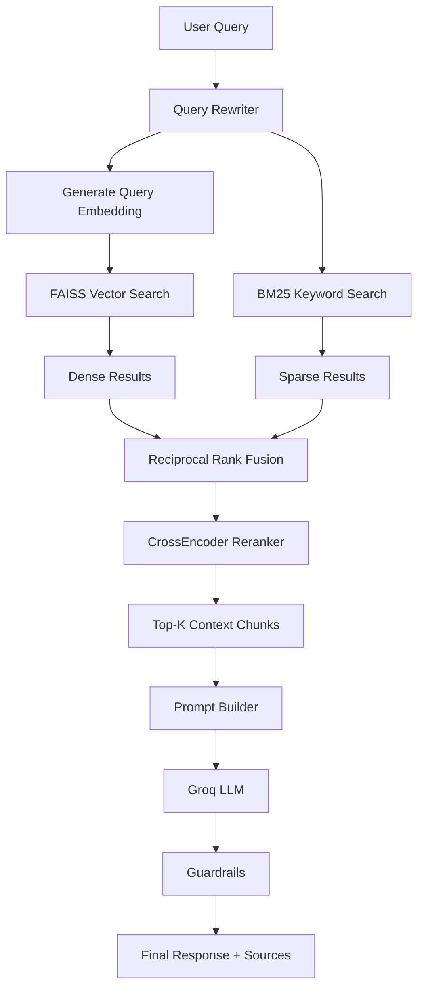

# GEN-RAG: Production-Ready Retrieval-Augmented Generation Chatbot

A production-ready Retrieval-Augmented Generation (RAG) chatbot built with FastAPI, Streamlit, FAISS, Sentence Transformers, BM25, CrossEncoder Reranking, and Groq LLMs.

The application enables users to upload PDF, TXT, and JSON documents, indexes them locally using vector embeddings and keyword search, and answers questions using Retrieval-Augmented Generation.

## Features

PDF document ingestion
TXT document ingestion
JSON document ingestion
Recursive text chunking
SentenceTransformer embeddings
Local FAISS vector database
BM25 sparse retrieval
Hybrid Retrieval (Dense + Sparse)
Reciprocal Rank Fusion (RRF)
CrossEncoder reranking
Query rewriting
Prompt engineering
LLM answer generation
Guardrails against hallucination
Source attribution
Streamlit chat interface
FastAPI backend
Docker support

## Tech Stack
### Backend
Python 3.11
FastAPI
Uvicorn
### Frontend
Streamlit
### Retrieval
FAISS
SentenceTransformers
Rank-BM25
### Reranking
CrossEncoder
### LLM
Groq API
### Document Processing
PyMuPDF
LangChain Text Splitters
### Deployment
Docker
Docker Compose

## Project Structure
## 📂 Project Structure

```text
GEN-PROJECT/
│
├── app.py                          # FastAPI application entry point
├── Dockerfile
├── docker-compose.yml
├── requirements.txt
├── README.md
│
├── config/
│   └── settings.py                 # Project configuration
│
├── deployment/
│   ├── api.py                      # API router
│   └── routes/
│       ├── chat.py                 # Chat endpoints
│       └── upload.py               # Upload endpoints
│
├── frontend/
│   └── app.py                      # Streamlit application
│
├── generation/
│   ├── guardrails.py               # Response validation
│   ├── llm.py                      # Groq LLM wrapper
│   └── prompt_builder.py           # Prompt construction
│
├── indexing/
│   ├── embedder.py                 # Embedding model
│   └── vector_store.py             # FAISS vector database
│
├── ingestion/
│   ├── chunker.py                  # Recursive text chunking
│   └── loaders.py                  # PDF/TXT/JSON loaders
│
├── pipeline/
│   ├── ingestion_pipeline.py       # Document ingestion
│   ├── pipeline_manager.py         # Shared pipeline instances
│   └── rag_pipeline.py             # Complete RAG pipeline
│
├── retrieval/
│   ├── query_rewriter.py           # Query expansion
│   ├── reranker.py                 # CrossEncoder reranking
│   └── retriever.py                # Hybrid retrieval
│
├── schemes/
│   ├── chat.py                     # Chat schemas
│   └── upload.py                   # Upload schemas
│
├── utils/
│   └── logger.py                   # Logging
│
├── data/
│   ├── uploads/                    # Uploaded documents
│   └── vector_store/               # FAISS index & metadata
│
└── logs/
    └── app.log
```

## Environment Variables

Create a .env file in the project root.

############################################
### LLM
############################################

GROQ_API_KEY=your_groq_api_key

############################################
### Models
############################################

EMBEDDING_MODEL=sentence-transformers/all-MiniLM-L6-v2

RERANKER_MODEL=cross-encoder/ms-marco-MiniLM-L-6-v2

LLM_MODEL=llama-3.3-70b-versatile

############################################
### Retrieval
############################################

TOP_K=5

USE_HYBRID=True

############################################
### Chunking
############################################

CHUNK_SIZE=800

CHUNK_OVERLAP=100

############################################
### Embeddings
############################################

EMBEDDING_DIM=384

############################################
### Vector Store
############################################

FAISS_INDEX_PATH=data/vector_store

############################################
### Logging
############################################

LOG_LEVEL=INFO

############################################

## Installation

### Clone the repository:
git clone https://github.com/yourusername/GEN-RAG.git

cd GEN-RAG

### Create a virtual environment
python -m venv venv
-activate it --->venv\Scripts\activate

### Install dependencies
pip install -r requirements.txt

## Quick Start
### 1. Start the FastAPI backend
backend--> uvicorn app:app --reload

Swagger--> http://localhost:8000/docs

### 2. Launch Streamlit
streamlit run frontend/app.py

http://localhost:8501

### 3. Upload documents

*Supported formats

PDF
TXT
JSON

*The ingestion pipeline automatically

Loads documents
Splits into chunks
Generates embeddings
Stores vectors in FAISS
Builds BM25 index

## Docker

### Build

docker compose build

### Run

docker compose up

### Stop

docker compose down

### Frontend

http://localhost:8501

### Backend

http://localhost:8000

### Swagger

http://localhost:8000/docs

## Retrieval Pipeline

## 🔄 Retrieval Pipeline

